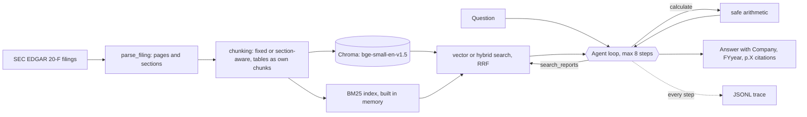

# rag-qa-agent

An agent that answers questions about company annual reports, with page citations, and handles questions that compare companies or years.


This is my first project in AI and machine learning. I built it solo over four weeks. The question I started with was simple: can I ask a plain question about four 200-page annual reports and get a correct answer that tells me which page it came from?

The reports are the latest two SEC Form 20-F filings from Sea Limited (Shopee, Garena, Monee) and Grab Holdings. I built a pipeline that parses them, cuts them into searchable pieces and stores them in a vector database. Then I built two ways of answering questions on top: a basic one that searches once, and an agent that decides what to search for, searches several times and does its own arithmetic. I measured both on 30 questions I checked by hand against the source filings.

The short version: basic RAG got 50%, and the agent got 90-100%. The long version is the part I learned the most from, so most of this document is about what went wrong and why.

## Contents

- [Results](#results)
- [How it works](#how-it-works)
- [The models and tools I used](#the-models-and-tools-i-used)
- [Challenges and what I learned](#challenges-and-what-i-learned)
- [What I would do differently](#what-i-would-do-differently)
- [Try it](#try-it)
- [Setup and run (Windows)](#setup-and-run-windows)

## Results

Agent vs basic RAG, same 30 questions (10 lookups, 10 narrative, 10 comparisons), correct / total. 5 of the 30 were used to tune the agent prompt, and single runs vary:

| Question type | Basic RAG | Agent (vector, final prompt) | Agent (hybrid, final prompt) |
|---|---|---|---|
| Lookup | 80% | 80% | 100% |
| Narrative | 40% | 100% | 100% |
| Comparison | 30% | 100% | 90% |
| All | 50% | 93% | 97% |

The agent costs more: about 11-12k input tokens and 7-8s per question against about 2.5k and 3s for basic RAG. Comparisons cost about 17-21k tokens.

Basic RAG baseline in detail (section chunks, k = 5, no filters):

| Question type | Retrieval strict hit@5 | Answer correct | Answer abstained |
|---|---|---|---|
| Lookup | 90% | 80% | 10% |
| Narrative | 50% | 40% | 50% |
| Comparison | 10% | 30% | 70% |
| All | 50% | 50% | 43% |

No answer was graded wrong: every failure was an abstention or a partial answer, and retrieval was the bottleneck.

Retrieval strict hit@k, all 30 questions (chunking strategy: fixed / section):

| k | 3 | 5 | 10 | 20 |
|---|---|---|---|---|
| Strict hit@k | 47% / 47% | 50% / 50% | 60% / 57% | 67% / 70% |

Details are in the weekly notes: [week 1](notes/week1-summary.md), [week 2](notes/week2-summary.md), [week 3](notes/week3-summary.md), plus [every failed question](notes/failures.md). The full analysis is in [notes/writeup.md](notes/writeup.md).

## How it works



Basic RAG (`--mode rag`) is the same retrieval with one search and no loop.

1. `scripts/download_filings.py` pins the latest two 20-F filings per company from SEC EDGAR.
2. `src/parse_filing.py` splits each filing into printed pages and tags every block with its page number and section.
3. `src/chunking.py` builds fixed-size and section-aware chunks, with tables as separate markdown chunks.
4. `src/ingest.py` embeds the chunks and stores them in a local Chroma collection per strategy.
5. `src/retrieve.py` searches a collection, optionally filtered by company and year, with an optional hybrid (BM25 + vector) mode.
6. `src/rag.py` asks Claude to answer from the top-k chunks only, citing `[Company, FYyear, p.X]`; `src/citations.py` parses those citations.
7. `src/tools.py` and `src/agent.py` are the agent: a `search_reports` tool, a `calculate` tool (an `ast` whitelist, no `eval`), and a tool-use loop with a step cap and a JSONL trace per question.
8. `eval/` measures everything: whether the gold pages come back in the top k, whether the answers are correct, and whether the citations point at the right pages.

## The models and tools I used

| Part | Choice | Why |
|---|---|---|
| Answering and agent | Claude (`claude-sonnet-5`) with tool use | Tool use gives the agent its search and calculator tools without a framework |
| Grading | A separate Claude call, plus a plain-code number check | An LLM grader can be too strict or too generous, so the number check catches disagreements |
| Embeddings | `BAAI/bge-small-en-v1.5` (sentence-transformers) | Free, runs locally on CPU |
| Vector store | Chroma, one collection per chunking strategy | Local, stores company, year, page, section and `is_table` as metadata |
| Keyword search | My own Okapi BM25, merged with vector results by reciprocal rank fusion | Finds exact terms such as statement names that vector search misses |
| Parsing | `beautifulsoup4` on the EDGAR inline-XBRL HTML | Keeps the printed page number on every chunk |
| Eval | Plain Python and a CSV of 30 questions | No framework, so I understand every metric |

I did not use LangChain or LlamaIndex. I wanted to see each step myself.

## Challenges and what I learned

This was my first project in this field, so these are the problems that taught me the most.

**1. Parsing three different filing formats.**
The four filings come from three different HTML generators (Broadridge, Donnelley and Workiva). They mark page breaks and headings differently, and some pages print no page number at all (the cover, the contents, the signature page). I ended up relying only on signals all three share, and labelled unnumbered pages like `s152` so they cannot collide with real ones. Workiva also splits a long table in two at a page break, which my parser keeps as two chunks. *Lesson: real documents are messy, and every later step depends on getting the page numbers right, so I built the checks first.*

**2. Checking the eval set myself.**
I had the 30 questions drafted, then checked each one by hand against the source filing: open the filing, search for the evidence, confirm the printed page number. It was slow, and it caught problems. The "gold page" only counts pages where the evidence appears word for word, so a page that states the same fact differently counts as a miss. *Lesson: an eval set you did not check is worthless, and the checking is where I learned what the questions actually need.*

**3. The bottleneck was retrieval, not the model.**
My first guess was that the model would make things up. It did not: across 30 questions, basic RAG gave no wrong answers. All 15 failures were "I don't know" (13) or partial answers (2). The answer score (50%) matched the retrieval score (50%). When the right text reached the model, it answered correctly; the problem was getting it there. *Lesson: measure retrieval and answers separately, or you will fix the wrong thing.*

**4. Why retrieval failed.**
Reading all the failures one by one, I found the same few patterns:
- The wrong year wins: the FY2024 report repeats much of the FY2025 text.
- Putting "according to the annual report" in a question pulls in cover and signature pages, which mention it constantly.
- The business overview outranks the section that explains the numbers.
- Balance-sheet lookups land on the discussion text, not the table (Sea's cash, question L06).

A perfect company and year filter fixed only 2 of 30, so filtering alone was not the answer. *Lesson: look at the individual failures, not just the score.*

**5. Comparison questions need more than one search.**
One search for "whose revenue grew faster, Sea or Grab?" usually returns one company's pages. Strict hit@5 was 10% on comparisons. This is why I built the agent: it makes one search per company and year, then calculates the growth rates with a calculator tool so the model never does arithmetic itself. Comparison accuracy went from 30% to 90-100%. *Lesson: the architecture has to match the question; a single search cannot answer a question that needs two.*

**6. The two chunking strategies tied.**
I expected the section-aware chunks to beat fixed windows. Both scored 50% at k = 5, and they failed on the same questions. Chunking was not the bottleneck; ranking was. *Lesson: a result that disproves your expectation is still a result, and it saved me from tuning the wrong thing for weeks.*

**7. Results change from run to run.**
The SDK would not let me set the model's temperature, so the same setup gave 90%, 90% and 93% on three runs. I also used 5 of the 30 questions to tune the prompt, so the agent scores are not a clean held-out result. I kept the prompt changes generic and wrote the caveats down in the write-up. Hybrid search is the default because it fixed misses (L06, L07) that prompt changes did not, not because of a few points of accuracy. *Lesson: with 30 questions, one question is 3.3 points. Report the spread and say what you tuned on.*

**8. The agent costs about 5x the tokens.**
It is worth it for comparisons and narrative questions, where basic RAG abstained on 70% and 50% of them. For simple lookups, basic RAG already scored 80-90%, so the agent mostly adds cost. *Lesson: accuracy is only half the answer; I should send each question type to the cheapest method that works.*

**9. Citations are still weaker than answers.**
Every page the agent cited was really retrieved (100%), so it never invented a citation. But only about 64% matched my gold pages, because it often cites another page that also supports the claim. I left this as a known limitation.

## What I would do differently

The full list, with the reasoning, is in [section 5 of the write-up](notes/writeup.md). In short:

- **A better data bank, not a bigger question bank.** Extract the financial statement line items into a structured table (company, year, metric, value, page), so a comparison becomes a query instead of several text searches.
- **Run each setup 3+ times** and average, to see the real spread.
- **Add a query router and a reranker,** so simple lookups take the cheap path and comparisons take the agent.

## Try it

```powershell
.venv\Scripts\python.exe main.py "Whose revenue grew faster in FY2025, Sea or Grab?"
.venv\Scripts\python.exe main.py "Whose revenue grew faster in FY2025, Sea or Grab?" --trace
.venv\Scripts\python.exe main.py "What was Sea's total revenue in 2025?" --mode rag --company Sea --year 2025
```

The default is the agent with hybrid search (keyword BM25 plus vector, fused by reciprocal rank fusion). `--vector` switches to vector only, `--trace` prints each step, and `--mode rag` is the single-retrieval baseline. This needs the filings ingested first (see below) and an `ANTHROPIC_API_KEY` in `.env`.

## Setup and run (Windows)

You need Windows with Python 3.12. Run every command from the repo folder in PowerShell. Only the steps marked "needs an API key" call Claude, and each person needs their own Anthropic API key (your `.env` file is gitignored, so keys are never uploaded).

### 1. Install

```powershell
cd rag-qa-agent
py -3.12 -m venv .venv
.venv\Scripts\python.exe -m pip install -r requirements-dev.txt
copy .env.example .env
```

### 2. Add your keys

Open `.env` and set two values:

- `SEC_USER_AGENT`: your name and email. SEC EDGAR requires it to download the filings.
- `ANTHROPIC_API_KEY`: your Anthropic API key. Only steps 4 and 5 need it.

### 3. Build the search index (no API key)

```powershell
$env:PYTHONUTF8 = "1"
.venv\Scripts\python.exe -m scripts.download_filings
.venv\Scripts\python.exe -m src.ingest
```

The first command downloads the four 20-F filings from SEC EDGAR. The second parses them, cuts them into chunks and embeds them into a local Chroma database (about 5 minutes on a CPU). To preview the parsing and chunking without embedding, add `--dry-run` to the second command; it writes the result to `data/processed/`.

Check that search works:

```powershell
.venv\Scripts\python.exe -m src.retrieve "What was Sea's total revenue in 2025?" --company Sea --year 2025
```

### 4. Ask questions (needs an API key)

The agent and basic RAG commands are in [Try it](#try-it). To run basic RAG directly:

```powershell
.venv\Scripts\python.exe -m src.rag "What was Sea's total revenue in 2025?" --company Sea --year 2025
```

### 5. Reproduce the results

Each command below produces one of the tables in [Results](#results). Run them as `.venv\Scripts\python.exe -m <command>`.

| Command | What it does | Calls Claude? |
|---|---|---|
| `eval.gold_tools check` | Checks that every gold page for the 30 questions really contains its evidence | No |
| `eval.retrieval_eval` | Retrieval hit@5 for both chunking strategies, by question type | No |
| `eval.experiments sweep` | Retrieval hit@k for k = 3, 5, 10 and 20 | No |
| `eval.experiments oracle --k 5` | What a perfect company and year filter would gain | No |
| `eval.answer_eval` | Answers all 30 questions with basic RAG, then grades them | Yes, about 60 calls |
| `eval.answer_eval --mode agent --tag my-run` | The same, with the agent (results saved under the tag) | Yes, more tokens per question |

The two experiments make no Claude calls unless you add `--answers`.

### 6. Tests and lint

```powershell
.venv\Scripts\python.exe -m pytest
.venv\Scripts\python.exe -m ruff check .
```

## Credits

Filings: Sea Limited and Grab Holdings Form 20-F, from SEC EDGAR. Embeddings: BAAI `bge-small-en-v1.5`. I built this with help from Claude Code; I checked the eval set against the filings myself, ran the experiments and wrote the write-up.
