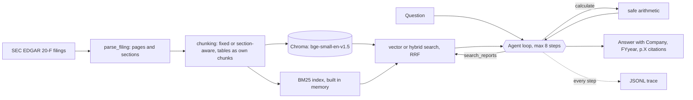

# rag-qa-agent

Agentic RAG over company annual reports, with citations and evals.

The agent answers questions about Sea Limited's and Grab Holdings' annual reports (SEC Form 20-F).
Every answer cites the report page it came from, and questions can compare companies or years.

## Status

All four weeks are built: ingestion and retrieval, basic RAG, an agent (Claude tool-use loop with `search_reports` and `calculate`) with optional hybrid search, and a CLI. The write-up is in [notes/writeup.md](notes/writeup.md).

Agent vs basic RAG, same 30 questions (correct / total; 5 of the 30 were used to tune the agent prompt, and single runs vary):

| Question type | Basic RAG | Agent (vector) | Agent (hybrid search, 1 run) |
|---|---|---|---|
| Lookup | 80% | 80% | 100% |
| Narrative | 40% | 90% | 100% |
| Comparison | 30% | 100% | 100% |
| All | 50% | 90% (two runs: 90%, 90%) | 100% |

The agent costs more: about 11.9k input tokens and 8.6s per question against about 2.5k and 3s for basic RAG. See [notes/week3-summary.md](notes/week3-summary.md).

Baseline (Week 2) results on the 30 verified questions (section chunks, k = 5, no filters):

| Question type | Retrieval strict hit@5 | Answer correct | Answer abstained |
|---|---|---|---|
| Lookup | 90% | 80% | 10% |
| Narrative | 50% | 40% | 50% |
| Comparison | 10% | 30% | 70% |
| All | 50% | 50% | 43% |

No answer was graded wrong: every failure is an abstention or a partial answer, and retrieval is the bottleneck.
See [notes/week1-summary.md](notes/week1-summary.md) and [notes/week2-summary.md](notes/week2-summary.md) for the details, and [notes/failures.md](notes/failures.md) for every failed question.

Retrieval strict hit@k, all 30 questions (chunking strategy: fixed / section):

| k | 3 | 5 | 10 | 20 |
|---|---|---|---|---|
| Strict hit@k | 47% / 47% | 50% / 50% | 60% / 57% | 67% / 70% |

## Try it

```powershell
.venv\Scripts\python.exe main.py "Whose revenue grew faster in FY2025, Sea or Grab?"
.venv\Scripts\python.exe main.py "Whose revenue grew faster in FY2025, Sea or Grab?" --hybrid --trace
.venv\Scripts\python.exe main.py "What was Sea's total revenue in 2025?" --mode rag --company Sea --year 2025
```

The default is the agent. `--hybrid` adds keyword (BM25) search to the vector search, `--trace` prints each step, and `--mode rag` is the single-retrieval baseline. This needs the filings ingested first (see Run below) and an `ANTHROPIC_API_KEY` in `.env`.

## Architecture



Basic RAG (`--mode rag`) is the same retrieval with one search and no loop.

## How it works

1. `scripts/download_filings.py` pins the latest two 20-F filings per company from SEC EDGAR.
2. `src/parse_filing.py` splits each filing into printed pages and tags every block with its page number and section.
3. `src/chunking.py` builds fixed-size and section-aware chunks, with tables as separate markdown chunks.
4. `src/ingest.py` embeds the chunks with `BAAI/bge-small-en-v1.5` and stores them in a local Chroma collection per strategy.
5. `src/retrieve.py` searches a collection, optionally filtered by company and year.
6. `eval/retrieval_eval.py` measures whether the gold pages come back in the top k.
7. `src/rag.py` asks Claude to answer from the top-k chunks only, citing `[Company, FYyear, p.X]`; `src/citations.py` parses those citations.
8. `src/tools.py` and `src/agent.py` are the agent: a `search_reports` tool, a `calculate` tool (an `ast` whitelist, no `eval`), and a tool-use loop with a step cap and a JSONL trace per question. `src/retrieve.py` also has the optional hybrid (BM25 + vector) search.
9. `eval/answer_eval.py` grades each answer and its citations; `--mode agent` runs the agent instead. `eval/experiments.py` sweeps k and tests an oracle company and year filter.

## Setup (Windows)

```powershell
py -3.12 -m venv .venv
.venv\Scripts\python.exe -m pip install -r requirements-dev.txt
copy .env.example .env
```

Then set `SEC_USER_AGENT` in `.env` to your name and email; SEC EDGAR requires it.

## Run

```powershell
$env:PYTHONUTF8 = "1"
.venv\Scripts\python.exe -m scripts.download_filings
.venv\Scripts\python.exe -m src.ingest
.venv\Scripts\python.exe -m src.retrieve "What was Sea's total revenue in 2025?" --company Sea --year 2025
.venv\Scripts\python.exe -m eval.gold_tools check
.venv\Scripts\python.exe -m eval.retrieval_eval
.venv\Scripts\python.exe -m src.rag "What was Sea's total revenue in 2025?" --company Sea --year 2025
.venv\Scripts\python.exe -m eval.answer_eval
.venv\Scripts\python.exe -m eval.experiments sweep
.venv\Scripts\python.exe -m eval.experiments oracle --k 5
```

`eval.answer_eval` makes about 60 Claude calls (30 answers and 30 grades); the two experiments make none unless you add `--answers`.

`python -m src.ingest --dry-run` parses and chunks without embedding, and writes everything to `data/processed/` for inspection.

## Tests

```powershell
.venv\Scripts\python.exe -m pytest
.venv\Scripts\python.exe -m ruff check .
```
