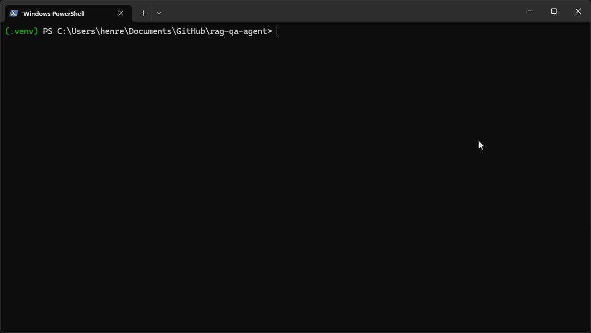
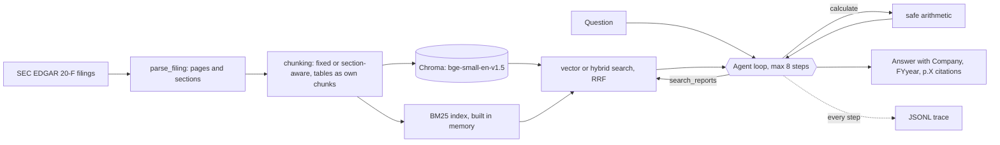

# rag-qa-agent

An agent that answers questions about company annual reports, with page citations, and handles questions that compare companies or years.



## In 30 seconds

- **What it is.** A solo project, built in four weeks as my first AI project. You ask a plain question about the latest two SEC annual reports (Form 20-F) from Sea Limited and Grab Holdings, and it answers with the page it found the evidence on.
- **Two setups, one test.** Basic RAG (retrieval-augmented generation) searches the reports once and answers from what it finds. The agent decides what to search for, searches several times and uses a calculator for the arithmetic. I scored both on 30 questions I checked by hand against the filings.
- **Result.** Basic RAG got 50% right and the agent got 90-100% depending on the run, at about 5 times the tokens.
- **Main finding.** Basic RAG never gave a wrong answer. It said "I don't know" or answered partly, so the real bottleneck was finding the right pages and not the model.

**Terms used below**

- **hit@k** is whether the right page shows up in the top k search results (strict means the page must contain the evidence word for word).
- **Gold pages** are the pages I verified by hand as holding the answer to each question.
- **Reciprocal rank fusion (RRF)** merges two ranked result lists (keyword and vector) by adding up a score that shrinks with each result's rank in each list, so results that rank well in both rise to the top.

## Contents

- [Results](#results)
- [How it works](#how-it-works)
- [Tools I used](#tools-i-used)
- [Challenges and what I learned](#challenges-and-what-i-learned)
- [What I would do differently](#what-i-would-do-differently)
- [Try it](#try-it)

## Results

Agent vs basic RAG on the same 30 questions (10 lookups, 10 narrative, 10 comparisons), correct out of total. Five of the 30 were used to tune the agent prompt, and single runs vary.

| Question type | Basic RAG | Agent (vector) | Agent (hybrid) |
|---|---|---|---|
| Lookup | 80% | 80% | 100% |
| Narrative | 40% | 100% | 100% |
| Comparison | 30% | 100% | 90% |
| All | 50% | 93% | 97% |

The agent costs more at about 11-12k input tokens and 7-8s per question, against about 2.5k and 3s for basic RAG. Comparisons cost about 17-21k tokens.

**Basic RAG in detail** (section chunks, k = 5, no filters). No answer was graded wrong. Every failure was an abstention or a partial answer.

| Question type | Strict hit@5 | Answer correct | Answer abstained |
|---|---|---|---|
| Lookup | 90% | 80% | 10% |
| Narrative | 50% | 40% | 50% |
| Comparison | 10% | 30% | 70% |
| All | 50% | 50% | 43% |

**Strict hit@k across all 30 questions, by chunking strategy.**

| k | Fixed-size chunks | Section-aware chunks |
|---|---|---|
| 3 | 47% | 47% |
| 5 | 50% | 50% |
| 10 | 60% | 57% |
| 20 | 67% | 70% |

More detail is in the weekly notes ([week 1](notes/week1-summary.md), [week 2](notes/week2-summary.md), [week 3](notes/week3-summary.md)), [every failed question](notes/failures.md) and the full [write-up](notes/writeup.md).

## How it works



Basic RAG (`--mode rag`) is the same retrieval with one search and no loop. The code is in `src/` (parsing, chunking, retrieval, the agent and its tools) and the measurements are in `eval/`.

## Tools I used

| Part | Choice | Why |
|---|---|---|
| Answering and agent | Claude (`claude-sonnet-5`, the model all results were measured on) with tool use | Gives the agent its search and calculator tools without a framework |
| Grading | LLM-as-judge (a separate Claude call) plus a deterministic number check | An LLM grader can be too strict or too generous, so the number check catches disagreements |
| Embeddings | `BAAI/bge-small-en-v1.5` (sentence-transformers) | Free and runs locally on CPU. I did not test newer models |
| Vector store | Chroma, one collection per chunking strategy | Local, and stores company, year, page, section and `is_table` as metadata |
| Keyword search | My own BM25 implementation, merged with vector results by RRF | Finds exact terms such as statement names that vector search misses |
| Parsing | `beautifulsoup4` on the EDGAR inline-XBRL HTML | Keeps the printed page number on every chunk |
| Evaluation | Plain Python and a CSV of 30 hand-verified questions | No framework, so I understand every metric |

I did not use LangChain or LlamaIndex. I wanted to see each step myself.

## Challenges and what I learned

**1. Parsing three different filing formats.** The four filings come from three HTML generators (Broadridge, Donnelley and Workiva) that mark page breaks and headings differently, and some pages print no page number at all. I relied only on signals all three share and labelled unnumbered pages like `s152` so they cannot collide with real ones. *Lesson. Every later step depends on getting the page numbers right, so I built the checks first.*

**2. Checking the eval set myself.** I opened each filing, found the evidence and confirmed the printed page number for all 30 questions. It was slow and it caught problems. A gold page only counts if the evidence appears word for word. *Lesson. An eval set you did not check is worthless.*

**3. The bottleneck was retrieval, not the model.** I expected the model to make things up. Across 30 questions, basic RAG gave no wrong answers. All 15 failures were "I don't know" (13) or partial answers (2), and the answer score (50%) matched the retrieval score (50%). *Lesson. Measure retrieval and answers separately, or you will fix the wrong thing.*

**4. Why retrieval failed.** Reading every failure showed a few patterns. The wrong year wins because the FY2024 report repeats much of the FY2025 text. Putting "according to the annual report" in a question pulls in cover and signature pages. The business overview outranks the section that explains the numbers. Balance-sheet lookups land on the discussion text and not the table (Sea's cash, question L06). A perfect company and year filter fixed only 2 of 30. *Lesson. Look at the individual failures, not just the score.*

**5. Comparison questions need more than one search.** One search for "whose revenue grew faster, Sea or Grab?" usually returns one company's pages, and strict hit@5 was 10% on comparisons. The agent makes one search per company and year, then uses the calculator so the model never does arithmetic itself. Comparison accuracy went from 30% to 90-100%. *Lesson. The architecture has to match the question.*

**6. The two chunking strategies tied.** Section-aware and fixed chunks both scored 50% at k = 5 and failed on the same questions, so ranking was the bottleneck and not chunking. *Lesson. A result that disproves your expectation still saves you from tuning the wrong thing.*

**7. Results change from run to run.** The SDK would not let me set the temperature, so the same setup scored 90%, 90% and 93% on three runs. I also used 5 of the 30 questions to tune the prompt, so the agent scores are not a clean held-out result. Hybrid search is the default because it fixed misses (L06, L07) that prompt changes did not. *Lesson. With 30 questions one question is 3.3 points, so report the spread and say what you tuned on.*

**8. The agent costs about 5x the tokens.** It is worth it for comparison and narrative questions, where basic RAG abstained on 70% and 50% of them, but for simple lookups basic RAG already scored 80%.

**9. Citations are weaker than answers.** Every page the agent cited was really retrieved (100%), so it never invented a citation. But only about 64% matched my gold pages, because it often cites another page that also supports the claim. I left this as a known limitation.

## What I would do differently

Each item below comes from a specific failure. The full reasoning is in [section 5 of the write-up](notes/writeup.md).

- **Build a structured table of financial line items** (company, year, metric, value, page). *Failure it fixes.* Question L06 (Sea's cash) landed on discussion text instead of the balance sheet, and comparisons scored only 10% strict hit@5 because one search returns one company's pages. With a table, a comparison becomes a query.
- **Run each setup 3 or more times and average.** *Failure it fixes.* The same agent scored 90%, 90% and 93% on three runs, so I cannot tell a real gain from noise when one question is worth 3.3 points.
- **Add a query router.** *Failure it fixes.* The agent used about 5 times the tokens on simple lookups, where basic RAG already scored 80%.
- **Add a reranker.** *Failure it fixes.* Wrong-year results and cover-page results outranked the right section (the FY2024 report repeats FY2025 text, and "according to the annual report" pulls in signature pages).

## Try it

Setup for Windows (Python 3.12, an SEC user agent and an Anthropic API key) is in [docs/setup-windows.md](docs/setup-windows.md). It also lists the commands that reproduce each results table. Once the filings are ingested, run the following.

```powershell
.venv\Scripts\python.exe main.py "Whose revenue grew faster in FY2025, Sea or Grab?"
.venv\Scripts\python.exe main.py "Whose revenue grew faster in FY2025, Sea or Grab?" --trace
.venv\Scripts\python.exe main.py "What was Sea's total revenue in 2025?" --mode rag --company Sea --year 2025
```

The default is the agent with hybrid search (BM25 plus vector, fused by RRF). `--vector` switches to vector only, `--trace` prints each step, and `--mode rag` is the single-retrieval baseline.

## Credits

Filings are Sea Limited and Grab Holdings Form 20-F, from SEC EDGAR. Embeddings are BAAI `bge-small-en-v1.5`. I built this with help from Claude Code. I checked the eval set against the filings myself, ran the experiments and wrote the write-up.
